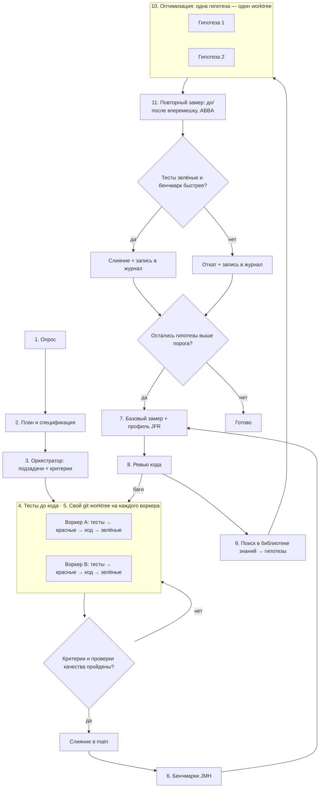

# Пайплайн разработки и оптимизации кода на Java

Порядок работы над задачей на Java: от постановки до кода с зелёными тестами, затем цикл оптимизации. В цикле код ускоряется только по замерам, а каждая правка опирается на источник из библиотеки знаний скилла. Пайплайн не зависит от предметной области и подходит для сервисов, библиотек, CLI, десктопных приложений, обработки данных и игр. Проверки качества собраны на Maven 3.9.16 и 3.10.0 и Gradle 9.8.2 с Temurin 25.0.5 и 27; бенчмарки и скрипт сравнения проверены на JMH 1.37 и Temurin 25.0.5 под Windows 11 (ноябрь 2026).

- [Схема](#схема)
- [Роли и модели](#роли-и-модели)
- [Этапы](#этапы)
- [Обязательные проверки качества](#обязательные-проверки-качества)
- [Этап 6. Бенчмарки](#этап-6-бенчмарки)
- [Этап 7. Базовый замер и профиль](#этап-7-базовый-замер-и-профиль)
- [Этап 8. Ревью кода](#этап-8-ревью-кода)
- [Этап 9. Поиск в библиотеке знаний](#этап-9-поиск-в-библиотеке-знаний)
- [Этапы 10–11. Оптимизация и повторный замер](#этапы-1011-оптимизация-и-повторный-замер)
- [Короткий режим](#короткий-режим)
- [Почему так](#почему-так)

## Схема



## Роли и модели

Пайплайн рассчитан на агента с субагентами. Если субагентов нет, один агент проходит те же этапы последовательно, а вместо worktree использует отдельные ветки.

| Роль | Рекомендуемая модель | Этапы |
| --- | --- | --- |
| Оркестратор: опрос, план, распределение работы, ревью, поиск решений, приёмка | Старшая модель, например Claude Opus 5.5 | 1–3, приёмка, 8, 9, решение на 11 |
| Воркер: основной код, тесты, бенчмарки, оптимизации | Средняя модель, например Claude Sonnet 5.5 | 4, 6, 10 |
| Рутина: простые правки, прогоны команд, сбор цифр | Быстрая модель, например Claude Haiku 4.5 | 4 (рутина), 7, 11 (замер) |

Старшая модель только управляет и проверяет. Основной объём кода пишут более дешёвые модели. Бенчмарки запускает всегда один исполнитель за раз: параллельные замеры на одной машине портят друг другу результаты, а JMH и сам не даёт запустить второй экземпляр (см. [этап 7](#этап-7-базовый-замер-и-профиль)).

## Этапы

| Этап | Что делает | Команда агенту |
| --- | --- | --- |
| 1. Опрос | Задаёт уточняющие вопросы: цель, ограничения, целевая версия Java (`maven.compiler.release` или toolchain в Gradle; на ноябрь 2026 LTS — 21 и 25, последняя — 27), дистрибутив JDK, Maven или Gradle, фреймворк, платформы и способ поставки (контейнер, jlink, native image), зависимости, которые нельзя добавлять, требования к задержке, пропускной способности, памяти и времени старта | «Прежде чем начать, задай мне вопросы по задаче» |
| 2. План и спецификация | Фиксирует план и спеку файлом. Отдельно перечисляет горячие пути и бюджет производительности: что, насколько быстрым и с какой памятью должно быть, на какой нагрузке и куче | «Составь план и спецификацию, отдельно перечисли критичные по скорости и памяти места» |
| 3. Оркестратор | Делит план на независимые подзадачи с критериями приёмки. Модули, пакеты и границы сверяет с [architecture.md](architecture.md) | «Разбей план на подзадачи с критериями готовности» |
| 4. Тесты до кода | Пишет тесты по спеке, видит красные, пишет код и чинит до зелёных. Правила для агента — в [testing.md](testing.md#правила-для-ии-агента-пишущего-тесты) | «Сначала тесты по спеке, запусти — должны быть красными. Потом код, пока все не зелёные» |
| 5. Изоляция | Отдельный git worktree на каждого воркера. Каталоги `target/` и `build/` у каждого свои; локальный репозиторий `~/.m2` и кэш Gradle общие и безопасны | «Работай в отдельном worktree, main не трогай» |
| Приёмка | Сверяет результат с критериями и [проверками качества](#обязательные-проверки-качества): слияние или возврат | «Проверь ветку по критериям и покажи вывод сборки, анализаторов и тестов» |
| 6. Бенчмарки | Пишет бенчмарки JMH на горячие пути из спеки. После этапа они заморожены | «Напиши бенчмарки JMH на горячие пути из спеки в модуле `benchmarks`» |
| 7. Базовый замер + профиль | Снимает базовую линию в 5 прогонов и профиль самого медленного сценария через JFR | «Сними 5 прогонов бенчмарков с `-prof gc` в `bench/before/` и JFR-профиль самого медленного сценария» |
| 8. Ревью кода | Стандартное ревью: баги, безопасность, идиоматичность, конкурентность, архитектура | «Сделай ревью: баги отдельно, замечания по скорости и дизайну отдельно» |
| 9. Поиск в библиотеке знаний | Сопоставляет профиль и замечания ревью с разделами справочников и пишет гипотезы | «По профилю и ревью найди решения в библиотеке знаний и оформи карточки гипотез» |
| 10. Оптимизация | Каждая гипотеза реализуется отдельно, тесты и бенчмарки не меняются | «Реализуй гипотезу N в отдельном worktree, тесты и бенчмарки не трогай» |
| 11. Повторный замер | Прогоняет бенчмарки «до» и «после» вперемешку в порядке ABBA и сравнивает скриптом, оркестратор решает: слить или откатить | «Сними по 5 чередующихся прогонов main и гипотезы и сравни скриптом BenchCompare» |

## Обязательные проверки качества

Перед любым слиянием в `main`, и на приёмке, и на этапе 11, ветка проходит минимальный набор проверок. Компилятор с `-Xlint:all -Werror`, Error Prone с NullAway, Spotless, тесты, интеграционные тесты и порог покрытия JaCoCo привязаны к стандартным фазам сборки, поэтому основная проверка — одна команда. Шаблоны `pom.xml`, `build.gradle.kts` и workflow для CI, собранные и проверенные локально, — в [toolchain.md → «Шаблоны»](toolchain.md#шаблоны).

**Maven:**

```bash
./mvnw -B -ntp verify                 # enforcer → компиляция (lint + Error Prone + NullAway) → unit-тесты → интеграционные тесты → spotless:check → jacoco:check
./mvnw -B -ntp dependency:analyze     # неиспользуемые и необъявленные зависимости
osv-scanner scan source -r .          # известные уязвимости в зависимостях
```

**Gradle:**

```bash
./gradlew build                       # spotlessCheck → компиляция (lint + Error Prone + NullAway) → test → jacocoTestCoverageVerification → assemble
./gradlew buildHealth                 # неиспользуемые зависимости; нужен плагин com.autonomousapps.dependency-analysis
osv-scanner scan source -r .
```

Оговорки, проверенные локально:

- **С JDK 23 javac не запускает аннотационные процессоры, найденные только на classpath.** Сборка проходит без ошибок, но сгенерированного кода нет: нет методов Lombok, мапперов MapStruct, списка бенчмарков JMH. Процессоры подключаются через `<annotationProcessorPaths>` в maven-compiler-plugin (3.16.0) или флагом `-proc:full`.
- **Error Prone на Maven требует `.mvn/jvm.config`** с флагами `--add-exports`. Без него сборка падает с единственным сообщением «An unknown compilation problem occurred». Весь `-Xplugin:ErrorProne ...` должен быть одним `<arg>`.
- **`mvn -q` прячет само предупреждение линтера** и печатает только «warnings found and -Werror specified». При разборе падения запускайте без `-q`.
- **JaCoCo с surefire:** в `argLine` пишите `@{argLine}`, а не `${argLine}`, иначе агент JaCoCo теряется и покрытие равно 0%.
- **Spotless на Windows** считает все файлы неверно отформатированными, пока окончания строк не закреплены как UNIX (`lineEndings` или `.gitattributes`).
- **Maven 3.10.0** (1 октября 2026) не запускается, если в пути установки есть `--`, и строже проверяет POM. Перед переходом проверьте сборку на нём отдельно. Maven 4 на ноябрь 2026 всё ещё RC (4.0.0-rc-7); плагины версий `4.0.0-beta-*` — только для Maven 4.
- **Gradle:** метаданные проверки зависимостей генерируются запуском настоящих задач (`--write-verification-metadata sha256 clean build`), а не `help`. Параметры `org.gradle.java.installations.*` передаются через `-D`: форма `-P` в Gradle 9 устарела.

По ситуации добавляются:

- прогон тестов на всех версиях JDK из матрицы поддержки (например, 21 и 25), если это библиотека;
- тесты архитектуры ArchUnit или проверка Spring Modulith, если границы модулей закреплены правилами ([architecture.md](architecture.md));
- SpotBugs с FindSecBugs и OWASP Dependency-Check для кода, чувствительного к безопасности ([toolchain.md](toolchain.md));
- japicmp, javadoc, подпись и `central-publishing-maven-plugin` для публикуемой библиотеки ([domains-client.md → «Чеклист ревью публикуемой библиотеки»](domains-client.md#чеклист-ревью-публикуемой-библиотеки));
- PIT по изменённым классам, если важна сила тестов; агент Mockito нужно передать и в `jvmArgs` PIT ([testing.md](testing.md));
- `zizmor .github/workflows`, если менялись workflow GitHub Actions.

Если инструмента нет в окружении, скажите об этом и предложите команду установки из [toolchain.md](toolchain.md), а не пропускайте шаг молча.

## Этап 6. Бенчмарки

- **Мерить то, что важно пользователю.** Горячие пути берутся из спеки, а не из догадок воркера. Это может быть разбор входа, обработка запроса, сериализация, работа с коллекцией, шаг симуляции, рендер шаблона.
- **Инструмент — JMH** (1.37, единственный стандарт для микробенчмарков на JVM). Самописный цикл с `System.nanoTime()` на JVM почти всегда врёт: JIT выкидывает неиспользуемый результат, сворачивает константы и компилирует код по-разному до и после прогрева.
- **Отдельный модуль.** На Maven — модуль `benchmarks` из архетипа `jmh-java-benchmark-archetype`, но архетип 1.37 устарел: он нацелен на Java 1.8 и maven-compiler-plugin 3.8.0. На JDK 23+ такой проект собирается без ошибок, а `java -jar target/benchmarks.jar` падает с `Unable to find the resource: /META-INF/BenchmarkList` (проверено локально). Исправленный `pom.xml` (`maven.compiler.release`, maven-compiler-plugin 3.16.0 с `<annotationProcessorPaths>` для `jmh-generator-annprocess`, maven-shade-plugin 3.6.2) — в [performance.md → «Бенчмарки: JMH»](performance.md#бенчмарки-jmh). На Gradle — плагин `me.champeau.jmh` 0.7.3 (работает на Gradle 9.8.2), бенчмарки в `src/jmh/java`.
- **Правила JMH:**
  - входные данные готовятся в `@Setup` объекта `@State`, а не в измеряемом методе;
  - результат возвращается из метода или передаётся в `Blackhole`. В локальном замере вычисление с выброшенным результатом выглядело в 14 раз дешевле настоящего;
  - размеры данных задаются через `@Param` и похожи на реальные, у генераторов случайных чисел фиксированный seed;
  - минимум `@Fork(2)`, прогрев `@Warmup` и замер `@Measurement` по нескольку итераций;
  - результат проверяется тестом, чтобы бенчмарк не мерил сломанный код.
- **Всегда добавляйте `-prof gc`.** Метрика `gc.alloc.rate.norm` (байт на операцию) почти не шумит: в пяти прогонах одного кода она совпала до байта, а время в тех же прогонах разошлось в 1,6 раза. Сокращение аллокаций видно по ней раньше, чем по времени. Метрика `gc.alloc.rate` в МБ/с вводит в заблуждение: у более быстрого кода она растёт, даже если он выделяет меньше.
- **Целиком программу** мерьте отдельно: старт CLI — `hyperfine --warmup 3 --export-json run1.json 'java -jar app.jar --version'`, HTTP-нагрузку — Gatling или k6 с фиксированной частотой запросов, паузы GC — по логу `-Xlog:gc*` или `jfr view gc-pauses`. Подробности — [performance.md → «Как бенчмаркать честно»](performance.md#как-бенчмаркать-честно).
- **Бенчмарки замораживаются.** Как и тесты, они контракт. Если на этапе 10 бенчмарк изменится, сравнение с базовой линией потеряет смысл.

## Этап 7. Базовый замер и профиль

```bash
mkdir -p bench/before
java -version 2> bench/before/env.txt          # на чём мерили; JMH пишет jdkVersion, vmVersion и jvmArgs и в каждый JSON
for i in 1 2 3 4 5; do
  java -jar benchmarks/target/benchmarks.jar -prof gc -rf json -rff bench/before/run$i.json
done
```

Для Gradle соберите jar задачей `./gradlew jmhJar` — получится `build/libs/<проект>-jmh.jar` — и запускайте его так же; так каждый прогон — отдельный запуск JVM без накладных расходов Gradle. Плагин `me.champeau.jmh` сам подключает процессор аннотаций JMH, поэтому подвоха JDK 23+ здесь нет (проверено локально: Gradle 9.8.2, JDK 25).

- **Один прогон ничего не доказывает.** Каждый запуск JMH — новые JVM: JIT принимает другие решения, меняются раскладка памяти и частота CPU. Статистика внутри прогона этот шум не видит. В замерах исследования три запуска одного и того же jar разошлись на 12–22%, а один бенчмарк показал 5,7 мкс в одном запуске и 7,4–8,5 мкс в других.
- **Пять прогонов, а не три.** При трёх прогонах на сторону одинаковый код случайно разделяется полностью с вероятностью 10%, при пяти — 0,8%. Скрипт сравнения печатает эту вероятность.
- **Одна машина, ничего лишнего.** Прогоны идут на одной машине, на одной сборке JDK и с одними флагами JVM, от сети на ноутбуке, без другой тяжёлой работы. В локальной проверке, пока на машине работали другие агенты, средние одного и того же кода в пяти прогонах разошлись в 1,6 раза, а ошибка JMH внутри прогона доходила до 28%. Скрипт сравнения предупреждает, если ошибка внутри прогона больше 10%.
- **Один JMH за раз.** JMH берёт блокировку `jmh.lock` во временном каталоге, и второй запуск на той же машине сразу завершается с ошибкой «Another JMH instance might be running». Это защита от зашумлённых замеров: не обходите её флагом `-Djmh.ignoreLock=true`, а запускайте бенчмарки последовательно.
- **Закрепите JDK.** `mvnw` и `gradlew` берут JDK из `JAVA_HOME`, а `java -jar` — из `PATH`. Проверьте, что это одна и та же сборка, и сравнивайте поле `jdkVersion` в JSON «до» и «после».
- **Профиль самого медленного сценария.** JFR работает на всех ОС и не требует установки:

  | Инструмент | Команда | Что даёт | Windows |
  | --- | --- | --- | --- |
  | JFR из JMH | `java -jar benchmarks.jar <имя> -prof jfr:dir=prof` | запись на каждый форк | да |
  | JFR в приложении | `java -XX:StartFlightRecording:filename=rec.jfr,settings=profile -jar app.jar` | профиль реальной нагрузки | да |
  | Разбор без GUI | `jfr view hot-methods rec.jfr`, `allocation-by-site`, `contention-by-site`, `gc-pauses`, `deoptimizations-by-reason` | горячие методы, места аллокаций, блокировки, паузы GC, деоптимизации — текстом, который агент читает сам | да |
  | Время методов (JEP 520, JDK 25) | `-XX:StartFlightRecording:method-timing=::<clinit>,filename=t.jfr`, затем `jfr view method-timing t.jfr` | точное время выбранных методов без агента | да |
  | Стек JMH | `-prof stack` | где проводят время потоки бенчмарка | да |
  | async-profiler 4.6 | `-prof "async:libPath=...;event=cpu;output=flamegraph"` | flame graph CPU, аллокаций, блокировок, wall-clock | нет, только Linux и macOS; на Linux `cpu` и `alloc` работают без root |
  | perfnorm, perfasm | `-prof perfnorm`, `-prof perfasm` | аппаратные счётчики на операцию, горячий машинный код | нет; на Linux нужны `perf`, `sudo sysctl kernel.perf_event_paranoid=1` и аппаратные счётчики — на раннерах GitHub их нет |
  | JDK Mission Control 9.1 | открыть `.jfr` | flame graph и автоматический анализ в GUI | да |

  Сэмплирование по CPU-времени (JEP 509) работает только на Linux, и там без root; на Windows запись проходит без ошибок, но в ней 0 сэмплов. Аппаратные события async-profiler (`event=cycles`) без прав дают пустой профиль, а JMH всё равно завершается с кодом 0 — смотрите лог на `perf_event_open ... failed`. Строки Linux в таблице проверены на Xubuntu 26.04 и на раннере GitHub Actions; эту проверку повторяет workflow `profilers.yml` в репозитории скилла. Подробности и выбор — [performance.md → «Профилирование»](performance.md#профилирование).
- Итог этапа — таблица: бенчмарк, медиана, разброс между прогонами, байт на операцию, топ горячих методов и мест аллокации из профиля.
- Если ревью на этапе 8 нашло баги и код после исправления поменялся, базовую линию нужно снять заново.

## Этап 8. Ревью кода

Ревью идёт до оптимизаций, потому что ускорять имеет смысл уже правильный код.

- Чеклисты:
  - идиоматичный код — [idioms-patterns.md → «Чеклист code review: идиоматичная Java»](idioms-patterns.md#чеклист-code-review-идиоматичная-java);
  - тесты — [testing.md → «Чеклист ревью тестов»](testing.md#чеклист-ревью-тестов);
  - потоки, виртуальные потоки, модель памяти и нативный код — [concurrency-native.md → «Чеклист ревью»](concurrency-native.md#чеклист-ревью);
  - серверный код, база данных и безопасность — [domains-server.md → «Чеклист ревью серверного кода»](domains-server.md#чеклист-ревью-серверного-кода);
  - публикуемая библиотека — [domains-client.md → «Чеклист ревью публикуемой библиотеки»](domains-client.md#чеклист-ревью-публикуемой-библиотеки);
  - архитектура — [architecture.md → «Чеклист ревью архитектуры»](architecture.md#чеклист-ревью-архитектуры).
- Находки делятся на две группы:
  - **баги** — неверное поведение, `NullPointerException` на корректном входе, незакрытые ресурсы, проглоченный `InterruptedException`, гонки и небезопасная публикация, нарушенный контракт `equals`/`hashCode`, `@Transactional` на вызове изнутри того же класса, блокирующие вызовы в реактивном конвейере, N+1 запросы, десериализация недоверенных данных, SQL-инъекции, XXE, path traversal, ReDoS, инъекции в логи. Возвращаются на этап 4 с тестом, который воспроизводит баг;
  - **можно сделать лучше** — скорость, память, дизайн, идиоматичность. Идут на вход этапа 9.

## Этап 9. Поиск в библиотеке знаний

Оркестратор идёт от симптома к справочнику. Главная точка входа — таблица «Симптом → техника → источник» в [performance.md](performance.md#симптом--техника--источник).

| Что видно в профиле или ревью | Куда смотреть |
| --- | --- |
| Горячий метод, лишняя работа в цикле, неудачная коллекция, упаковка примитивов, `String.format` в горячем пути | [performance.md → «Симптом → техника → источник»](performance.md#симптом--техника--источник), [«Техники в коде»](performance.md#техники-в-коде) |
| Высокий `gc.alloc.rate.norm`, долгие паузы GC, рост кучи, проблемы с памятью в контейнере | [performance.md → «Память и GC»](performance.md#память-и-gc) |
| Мегаморфные вызовы, деоптимизации, метод не инлайнится | [performance.md → «JIT и внутренности JVM»](performance.md#jit-и-внутренности-jvm) |
| Медленный старт, долгий прогрев, тяжёлые статические инициализаторы | [performance.md → «Старт и прогрев»](performance.md#старт-и-прогрев) |
| Конкуренция за блокировки, пул потоков упирается в предел, CPU-задача не масштабируется по ядрам | [concurrency-native.md → «Выбор инструмента по нагрузке»](concurrency-native.md#выбор-инструмента-по-нагрузке), [«Виртуальные потоки»](concurrency-native.md#виртуальные-потоки) |
| Горячий числовой код не ускорить на чистой Java, нужен нативный код или SIMD | [concurrency-native.md → «Нативный код: FFM API, JNI и Unsafe»](concurrency-native.md#нативный-код-ffm-api-jni-и-unsafe), [performance.md → «Техники в коде»](performance.md#техники-в-коде) |
| Медленный эндпоинт, N+1, исчерпан пул соединений, тяжёлая сериализация JSON | [domains-server.md → «Производительность сервера: симптомы»](domains-server.md#9-производительность-сервера-симптомы), [performance.md](performance.md) |
| Неудобные абстракции, лишние классы, глубокое наследование | [idioms-patterns.md → «Мини-каталог паттернов»](idioms-patterns.md#мини-каталог-паттернов), [«Антипаттерны»](idioms-patterns.md#антипаттерны) |
| Запутанные зависимости модулей, циклы между пакетами, долгая сборка | [architecture.md](architecture.md), [toolchain.md](toolchain.md) |
| Нужно глубже разобраться в теме | [books.md](books.md), [performance.md → «Разборы и кейсы»](performance.md#разборы-и-кейсы) |

Результат этапа — список карточек гипотез, отсортированный по ожидаемому эффекту:

```text
Гипотеза N: <что меняем>
Где: <класс и метод>
Почему: <горячее место из профиля, место аллокации или замечание ревью>
Источник: <ссылка из библиотеки знаний>
Ожидаемый эффект: <какой бенчмарк и насколько должен ускориться, сколько байт на операцию уйдёт>
Риск: <что может сломаться, нужна ли новая зависимость, флаги JVM (--add-opens, --enable-preview, --enable-native-access) или нативный код, совместимость с целевыми версиями JDK>
```

Если в библиотеке нет решения под найденную проблему, это пишется в карточке прямо, без выдуманного решения. Такой пробел — повод дополнить библиотеку.

## Этапы 10–11. Оптимизация и повторный замер

Каждая гипотеза реализуется в своём worktree, чтобы эффект был виден отдельно. Для решения базовая линия снимается **заново, вперемешку с прогонами гипотезы**. Старая линия из этапа 7 для этого не годится: за время работы над гипотезой состояние машины меняется (частота CPU, нагрев, фоновые задачи), и дрейф легко принять за ускорение. Порядок внутри пары меняется (ABBA): прогон, идущий сразу после другого варианта, бывает систематически быстрее или медленнее.

```bash
# ../wt-main — worktree с main, ../wt-hyp — worktree с гипотезой; в обоих собран benchmarks.jar
OUT=$PWD/bench; mkdir -p "$OUT/before" "$OUT/after"
run() { (cd "$1" && java -jar benchmarks/target/benchmarks.jar -prof gc -rf json -rff "$2"); }
for i in 1 2 3 4 5; do
  if [ $((i % 2)) = 1 ]; then
    run ../wt-main "$OUT/before/run$i.json"; run ../wt-hyp "$OUT/after/run$i.json"
  else
    run ../wt-hyp "$OUT/after/run$i.json"; run ../wt-main "$OUT/before/run$i.json"
  fi
done
java <путь к скиллу>/scripts/BenchCompare.java "$OUT/before" "$OUT/after" --threshold 5
```

На Windows цикл работает в Git Bash. Для одного бенчмарка добавьте его имя после `benchmarks.jar`, чтобы не гонять все. На Gradle замените путь к jar на `build/libs/<проект>-jmh.jar`.

[BenchCompare.java](../scripts/BenchCompare.java) — однофайловая программа без зависимостей, запускается командой `java BenchCompare.java` на JDK 17 и новее, без сборки. Она принимает JSON одного прогона JMH (`-rf json`) или папку с несколькими прогонами. Бенчмарки сопоставляются по имени, параметрам `@Param` и режиму. Для каждого бенчмарка скрипт печатает медианы оценок, изменение и байты на операцию, если прогон снят с `-prof gc`:

- направление учитывается по режиму: в `thrpt` больше — лучше, в `avgt`, `sample` и `ss` меньше — лучше;
- вердикт `faster` или `slower` ставится, только если медиана оценок сдвинулась больше порога и оценки всех прогонов одной стороны лежат строго по одну сторону от другой; иначе `same`;
- скрипт печатает вероятность, с которой одинаковый код разделился бы случайно при таком числе прогонов, — на один бенчмарк и на весь набор: при 16 бенчмарках и 5 прогонах на сторону хотя бы один ложный вердикт возможен с вероятностью до 12%. Если хотя бы с одной стороны прогон один, скрипт сравнивает 99,9% доверительные интервалы JMH и предупреждает, что такому вердикту доверять нельзя;
- если ошибка JMH внутри прогона больше 10% оценки, скрипт предупреждает: проверьте прогрев, число форков и фоновую нагрузку;
- бенчмарк с разными единицами по сторонам (поменяли `-tu` или `@OutputTimeUnit`) получает `unit-mismatch`, с NaN в оценке — `invalid`; такие строки не сравниваются. Бенчмарки, которые есть только с одной стороны (переименовали метод, поменяли `@Param` или режим), перечисляются в предупреждении;
- код выхода 1 — хотя бы один бенчмарк замедлился; 2 — ошибка ввода, несравнимые строки или ни одного бенчмарка, который есть с обеих сторон.

Проверено на JMH 1.37 и Temurin 25.0.5 (Windows 11), по 5 прогонов на сторону в порядке ABBA. Неизменённый код получил `same` при сдвиге медиан на 2,8% и 4,7%. Замена `+=` в цикле на `StringBuilder` получила `faster`: −72% и −97% по времени, в 12 и 137 раз меньше байт на операцию. Обратное сравнение дало `slower` с кодом выхода 1. Режим `thrpt` проверен отдельно.

Гипотеза сливается в `main`, только если выполнены все условия:

1. Все [проверки качества](#обязательные-проверки-качества) пройдены, тесты зелёные.
2. У целевого бенчмарка вердикт `faster`, а выигрыш не меньше порога из спеки. Порог по умолчанию — 5%. Для микробенчмарков короче микросекунды берите 10%. Если цель — сократить аллокации, критерий — падение `gc.alloc.rate.norm` при времени не хуже `same`.
3. Остальные бенчмарки не получили `slower`, байты на операцию и бюджет памяти из спеки не выросли.
4. Код не стал заметно хуже: оркестратор коротко проверяет правку. Новая зависимость, флаги JVM (`--add-opens`, `--enable-preview`, `--enable-native-access`) или нативный код через FFM и JNI оправданы выигрышем и согласованы с пользователем. Нативный код собирается на всех целевых платформах. Тесты проходят на всех версиях JDK из матрицы поддержки.

Иначе worktree удаляется. В обоих случаях результат записывается в журнал оптимизаций, например `docs/perf-log.md`:

| Гипотеза | Источник | До | После | Решение |
| --- | --- | --- | --- | --- |
| `+=` в цикле → `StringBuilder` в `Join.join` | ссылка из библиотеки | 517 мкс, 3,5 МБ/оп | 15,7 мкс, 25 КБ/оп | слита |

Журнал не даёт повторно проверять отклонённые идеи. Если гипотезы сливались, следующий круг начинается с нового main. Цикл 7–11 повторяется, пока остаются гипотезы с ожидаемым эффектом выше порога.

## Короткий режим

Для небольшой задачи (один метод, один баг) весь пайплайн избыточен. Достаточно:

1. Тест, который воспроизводит задачу.
2. Код до зелёного теста.
3. [Проверки качества](#обязательные-проверки-качества).
4. Ревью по чеклисту из [idioms-patterns.md](idioms-patterns.md#чеклист-code-review-идиоматичная-java).

Цикл оптимизации запускается, только если в задаче есть требование к скорости или памяти или профиль показал проблему.

## Почему так

- **Тесты — это контракт.** Если тесты написаны до кода, агент не подгонит их под уже сделанное. Фраза «готово, всё работает» без зелёного прогона ничего не значит.
- **Бенчмарки — тоже контракт.** Их пишут до оптимизаций и не трогают, поэтому «стало быстрее» подтверждается цифрами, а не ощущением.
- **JMH, а не самописный таймер.** JIT выкидывает неиспользуемую работу и компилирует код по-разному до и после прогрева. Только JMH управляет прогревом, форками и мёртвым кодом.
- **Шум измеряется, а не предполагается.** Пять чередующихся прогонов в порядке ABBA показывают разброс между запусками JVM и гасят эффект порядка. Одиночный замер выдаёт шум за ускорение.
- **Аллокации — самая честная метрика.** Байты на операцию почти не шумят, и их снижение обычно ведёт и к ускорению, и к меньшей нагрузке на GC.
- **Сначала корректность, потом скорость.** Ревью стоит до оптимизаций, и ускорять приходится уже правильный код.
- **Решения берутся из источников.** Каждая гипотеза ссылается на статью, доклад или книгу из библиотеки. Это отсекает выдуманные «оптимизации» и сразу даёт материал для разбора.
- **Одна гипотеза — один worktree.** Эффект каждой правки виден отдельно, и неудачную легко откатить, не задев удачные.
- **Worktree защищает main.** Параллельные воркеры не мешают друг другу и не ломают основную ветку. Замеры при этом идут строго по очереди.
